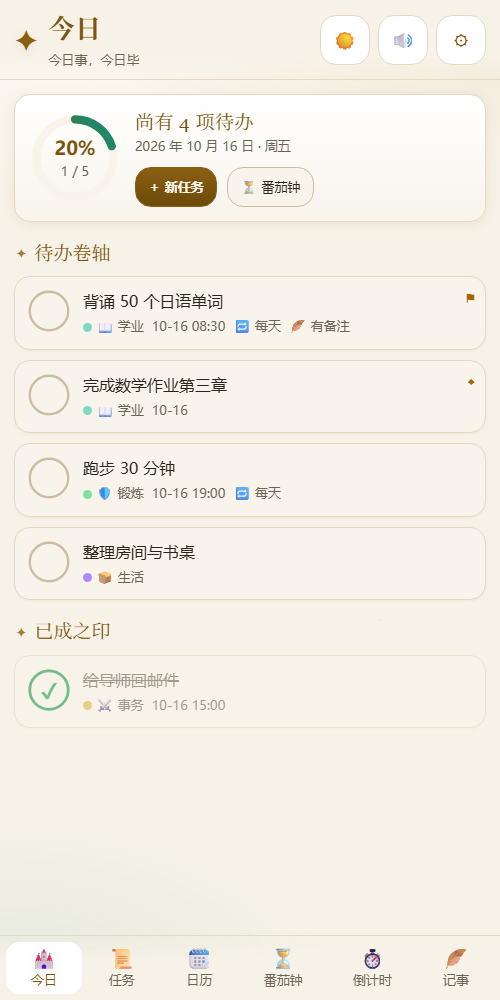
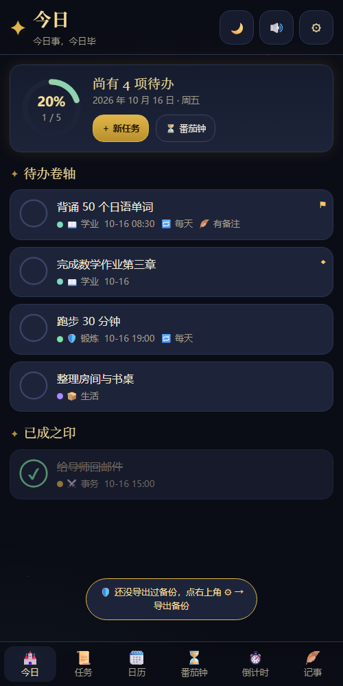

# 秘典任务栏 · Arcane Tasks

> 一个西幻风格的手机任务管理 PWA：任务分类、日历、倒计时、番茄钟、记事，支持 **浅色 / 深色** 一键切换与 **青少年 / 成人 / 老年大字** 三种使用模式。




## 功能

| 模块 | 说明 |
|---|---|
| 今日 | 进度环、待办与已完成分区、一键新建 |
| 任务 | 分类筛选、关键词搜索、优先级排序、重复任务（每天 / 每周自动生成下一次） |
| 完成方式 | 点环打勾（金环闭合 → ✔ 动画），或在「画圈模式」下**按住任务画一个整圈**完成 |
| 分类 | 6 个预置分类（可增删改名改色），带 emoji 与颜色标记 |
| 日历 | 月视图、分类色点、点日期看当天安排并就地加任务 |
| 倒计时 | 多个目标日，实时天/时/分/秒与进度条 |
| 番茄钟 | 专注 / 短休 / 长休可调，环形进度，**按时间戳计算所以后台不跑偏**，结束响铃 + 震动 + 系统通知，可关联任务 |
| 记事 | 标题 / 正文 / 分类 / 置顶 / 搜索 |
| 数据 | 全部保存在浏览器本地（localStorage），支持导出 / 导入 JSON 备份，超过 14 天未备份会提示 |

## 三种使用模式

- **青少年模式**：暖色护眼配色、圆润大按钮、每日修行时限（默认 60 分钟，到点提醒休息）、危险操作二次确认、无任何外部链接
- **成人模式**：全部功能开放
- **老年大字版**：高对比、超大字号（正文 21px / 标题 32px）、按钮加大到 66px、一键朗读当前页面与待办

明暗与模式可自由组合，共 6 种外观。

## 安装到手机

这是一个 PWA，用 **https 网址**打开即可安装（本地双击文件不支持安装）：

- **安卓 Chrome / Edge**：右上角 ⋮ →「安装应用」
- **iPhone Safari**：分享 ⬆️ →「添加到主屏幕」

安装后全屏运行、离线可用。数据保存在设备本地，不会上传到任何服务器。

## 本地运行

```bash
# 任选一种静态服务器
python -m http.server 8791
npx serve .
```

然后浏览器打开 `http://localhost:8791/`。

## 技术说明

- 纯静态单文件应用（`index.html` 内含全部 HTML/CSS/JS），无任何依赖、无构建步骤
- `manifest.webmanifest` + `sw.js` 提供安装与离线缓存
- 发音使用浏览器 SpeechSynthesis，番茄钟与倒计时基于时间戳计算
- 数据存储：浏览器 localStorage（键名 `arcane_tasks_v1`）

## 目录

```
index.html             应用主体
manifest.webmanifest   PWA 配置
sw.js                  Service Worker（离线缓存）
icon-192.png           图标
icon-512.png           图标
icon-maskable-512.png  安卓自适应图标
.nojekyll              关闭 GitHub Pages 的 Jekyll 处理
```

> 更新版本后，记得把 `sw.js` 第一行的缓存名 `arcane-tasks-v2` 递增为 `v3`，否则已安装的设备可能仍读旧缓存。
